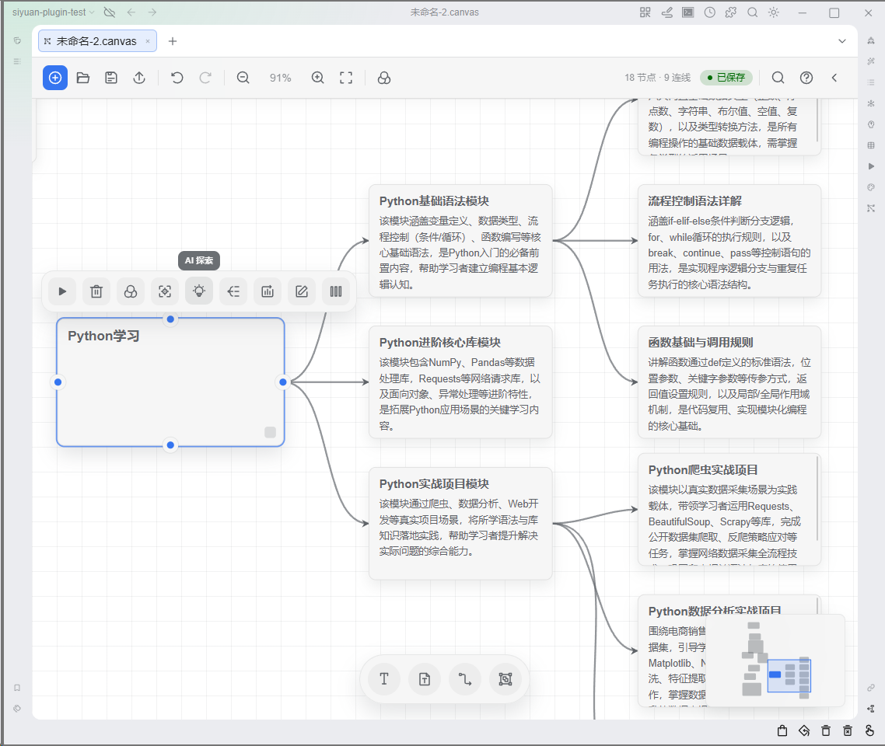
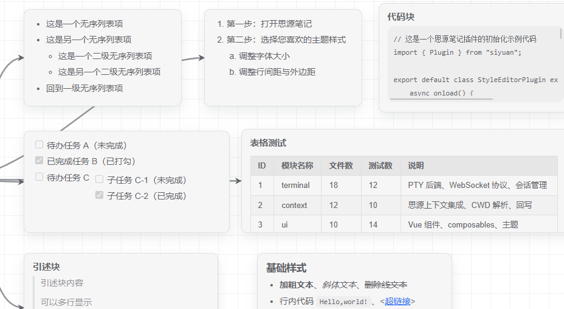
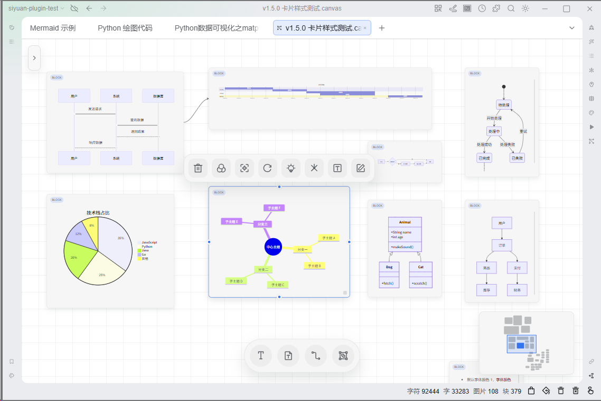
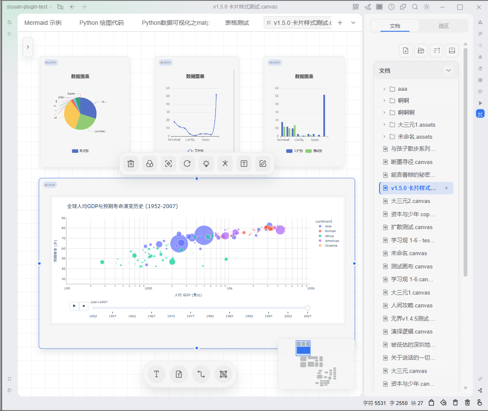
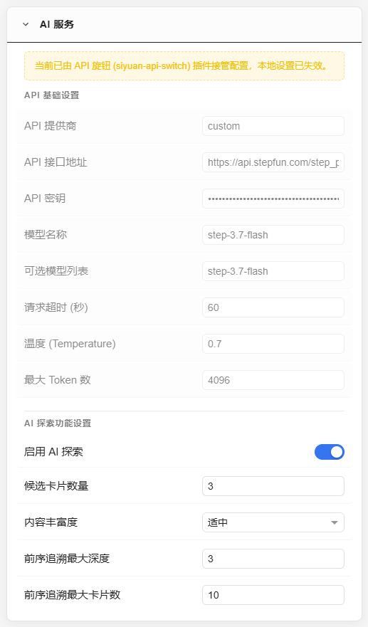

# AI 探索、流程图／思维导图／图表笔记卡片——无界 v1.5.0 新功能预览

思源笔记插件开发实践

## 无界 v1.5.0

### 新增

- **AI 探索（Beta）** ：基于当前节点内容以及前序连线形成的上下文脉络，自动进行主题下钻、知识发散或关联问题推演，并在画布中自动排布生成新卡片与连线。

  
- **Markdown 渲染引擎升级**：文本卡片Markdown渲染支持 GFM 规范，包括代码块与任务列表等；

  
- **Mermaid & ECharts 渲染**：笔记卡片支持渲染显示 Mermaid 流程图与 ECharts 图表；

  

  

### 改进

- **原生 Dock 面板**：将侧边栏改造为思源笔记原生侧栏 Dock 面板，提供文档树和选区属性视图；
- **顶部工具栏折叠**：支持将顶部工具栏折叠收缩为窄条，提升画布编辑视野；
- **其他UI和交互优化**：

  - 修复 Dock 侧面板新建画布无响应的问题，支持自动创建并立即打开画布编辑；
  - 修复节点溢出导致的连线锚点/连接点显示截断问题；
  - 重构设置项页面功能分类布局，新增 AI 服务设置项；

    
  - 支持通过键盘方向键精确微调选中节点的位置；
  - 笔记卡片点击“刷新”按钮会自适应调整卡片大小；

‍

## 附录

- [想象“无界”，思考有方 —— 一个兼容 Obsidian Canvas 的思源笔记插件 - 链滴](https://ld246.com/article/1777692508369) *
- [无界 v1.2.0 大幅更新预警！ - 链滴](https://ld246.com/article/1779503358420) *
- [让笔记与画布连接更紧密——无界 v1.3.0 新功能预览 - 链滴](https://ld246.com/article/1780823593732)
- [在笔记中嵌入 Canvas——无界 v1.3.5 新功能预览 - 链滴](https://ld246.com/article/1781407746870)
- [演示模式、视频卡片、移动端——无界 v1.4.0 新功能预览 - 链滴](https://ld246.com/article/1782050162702) *
- [动态查询卡片、自动生成 Canvas、扩散及更多功能——无界 v1.4.5 新功能预览 - 链滴](https://ld246.com/article/1783259364768) *
- [为了让思源笔记用起来更顺手，我打算开发 10 个插件，目前进度…… - 链滴](https://ld246.com/article/1775894033664)

‍

‍

‍
