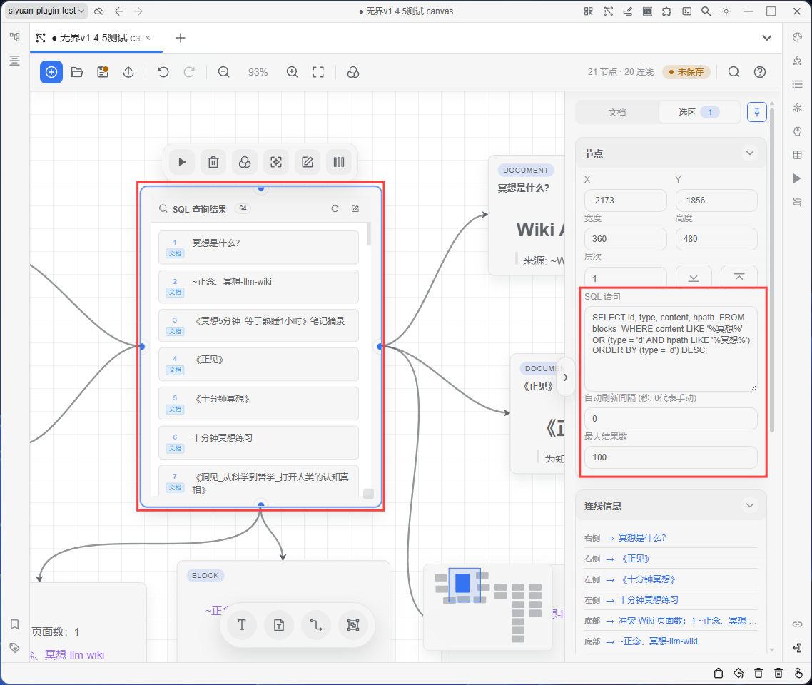
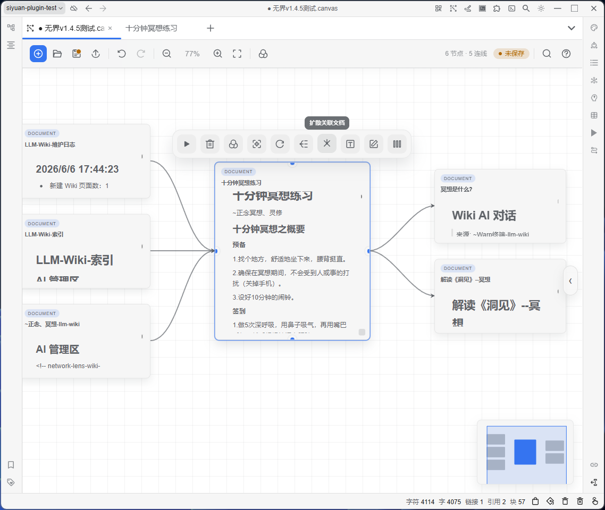
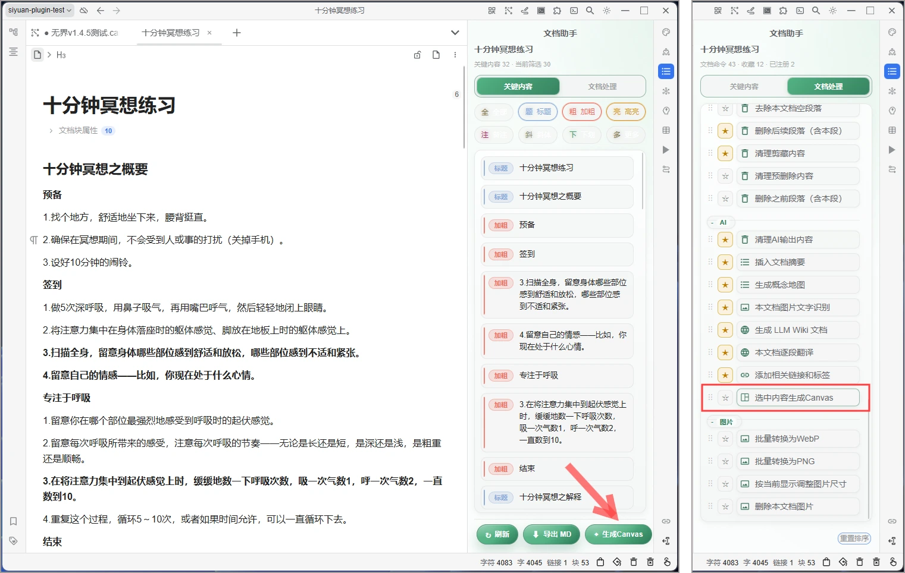
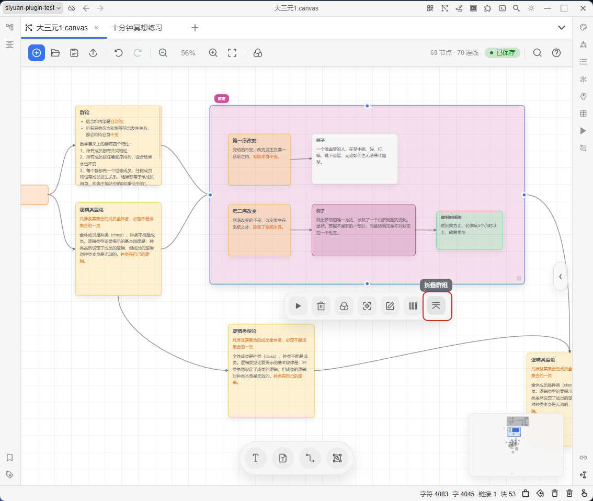
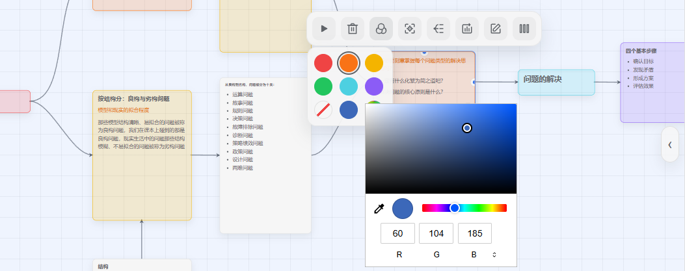
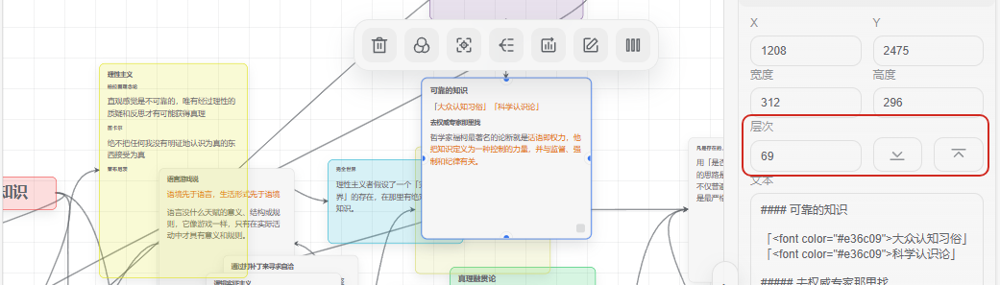

# 动态查询卡片、自动生成Canvas、扩散及更多——无界 v1.4.5 新功能预览

思源笔记插件开发实践

## 无界 v1.4.5 新功能预览

### **动态查询卡片**：支持 SQL 动态查询卡片，支持从动态查询结果拖出新卡片；



**场景1：专项研究与主题写作**

- **场景描述**：创作者在画布上研究某个特定主题可以在画布里输入 SQL 建立一个动态查询卡片：

  示例查询语句：包含“冥想”关键词的文档和块

  ```sql
  SELECT id, type, content, hpath 
  FROM blocks 
  WHERE content LIKE '%冥想%' OR (type = 'd' AND hpath LIKE '%冥想%')
  ORDER BY (type = 'd') DESC;
  ```

  **交互流**：

  1. 卡片实时汇聚了分散在整个知识库里所有包含该关键词的文献摘录，用户补充剪藏资料后，查询结果内容会自动刷新。
  2. 用户可以从列表挑出 3 个最有说服力的论点直接“拖出”到画布空白处，卡片自适应连线，然后在画布上对这 3 个论点进行重排、对比、并撰写自己的推论，完成从“知识碎块”到“大纲结构”的渐进式推演。

**场景2：项目与任务跟踪大盘**

- **场景描述**：在画布放置几个动态查询卡片作为“收件箱”或“分类大盘”。

  - 卡片 A（今日待办）：自动拉取所有包含 `- [ ]`​ 且打上了 `#今天` 标签的未完成任务块。
  - 卡片 B（延期预警）：自动拉取截止日期早于今天、状态仍为未完成的任务。
- **交互流**：

  1. 每天清晨打开画布，待办任务动态刷新呈现。
  2. 用户将待办任务汇总卡片拖拽到画布中央，然后可以在这个独立节点周围拖出子任务卡片，分别跟踪处理；

<video controls="controls" src="assets/动态查询卡片-20260705215314-exv6qx8.mp4"></video>

‍

### **扩散**：支持从笔记卡片扩散出关系图（正链、反链、子文档）；



**场景1：学术研究与文献追溯 —— “顺藤摸瓜”的演进网络**

- **场景描述**：学者在梳理某个领域的发展脉络时，将一篇里程碑式的核心论文 AA 拖入画布。
- **交互流**：

  1. 用户点击论文 AA 卡片，选择 “扩散”，画布上在 AA 卡片旁边自动创建它引用和引用它的关联文献卡片，自动建立指向 AA 的连线。一个学术演进脉络图在画布上自然形成。用户可以在连线上写下批注，梳理理论的进化过程。
  2. 可以与笔记卡片的“拆解”功能（按章节内容拆解子卡片）结合使用，将知识主题拆解出更加精细的知识点；

**场景2：复杂项目的影响范围分析**

- **场景描述**：软件工程师或系统架构师在重构一个公共代码模块 MM 的文档，需要评估修改 MM 会对系统中的其他哪些业务模块造成影响。
- **交互流**：

  1. 将“模块 MM 说明文档”拖入画布。点击“扩散”，画布瞬间把所有引用了 MM 的上游业务模块（如《订单支付流程》、《用户注册接口》）全部拉出来并连线。
  2. 架构师一目了然地看到受波及的范围，在画布上用红色高亮标出受影响的关键路径，以此制定重构测试方案。

<video controls="controls" src="assets/扩散-20260705211128-isbebj4.mp4"></video>

‍

### **自动生成Canvas**：联动“文档助手”插件，支持根据文档内容自动生成 .canvas 文件；

- 根据文档“关键内容”生成 .canvas；
- AI 总结文档内容生成 .canvas；



‍

### **折叠群组**：支持群组的折叠/展开；



‍

### **拖拽辅助线与吸附**：引入拖拽对齐辅助线与控制开关，启用后拖动卡片时会显示辅助线和吸附位置；

### **Ctrl 拖拽复制**：支持通过按住 `Ctrl`​ 键拖拽复制卡片；按住 `Ctrl + Shift` 沿水平/竖直方向进行复制；

<video controls="controls" src="assets/拖拽-20260705214605-c9i1zfn.mp4"></video>

‍

### **选色器增强**：支持自定义 HEX 选色；



‍

### **调整层次**：侧边栏增加调整层次快捷操作，支持置顶、置底、上移、下移，避免重要卡片内容被遮挡；



‍

### 其他改进

- **排版一致性**：接入思源内核渲染能力以优化卡片预览排版一致性；
- **其他细节优化**：

  - 新建文本卡片时不再添加默认文本；
  - 拖拽文本卡片端点的连线到空白处会自动创建新卡片；
  - 部分图标优化，提高辨识度；
  - 从命令面板中移出最近历史文档展示；

‍

## 附录

- [想象“无界”，思考有方 —— 一个兼容 Obsidian Canvas 的思源笔记插件 - 链滴](https://ld246.com/article/1777692508369) *
- [无界 v1.2.0 大幅更新预警！ - 链滴](https://ld246.com/article/1779503358420) *
- [让笔记与画布连接更紧密——无界 v1.3.0 新功能预览 - 链滴](https://ld246.com/article/1780823593732)
- [在笔记中嵌入 Canvas——无界 v1.3.5 新功能预览 - 链滴](https://ld246.com/article/1781407746870)
- [演示模式、视频卡片、移动端——无界 v1.4.0 新功能预览 - 链滴](https://ld246.com/article/1782050162702) *
- [为了让思源笔记用起来更顺手，我打算开发 10 个插件，目前进度…… - 链滴](https://ld246.com/article/1775894033664)
