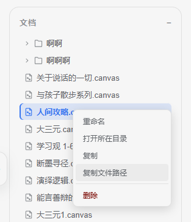
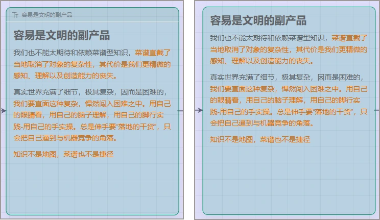

# 在笔记中嵌入Canvas——无界 v1.3.5 新功能预览

~思源笔记 [*](https://ld246.com/article/1781407746870)

## 无界 v1.3.5

### 新增

- 内置 4 套彩虹色系预设主题，支持卡片颜色主题快速切换；

  <video controls="controls" src="assets/2026-06-13-11-35-22-20260613113554-mn6dt9v.mp4"></video>
- 重布局（beta）：选中节点后沿连线关系自动重排连接节点，保证节点位置不重叠，减少手工排布卡片的工作量；

  <video controls="controls" src="assets/6月14日-20260614134726-adohrs1.mp4"></video>
- 支持在思源文档中插入 Canvas 预览块，点击即可跳转到无界编辑器；

  <video controls="controls" src="assets/2026-06-13-13-03-22-20260613130433-o3799e4.mp4"></video>

### 改进

- 连线面板和右侧栏的节点名称支持点击快速跳转到关联节点；

  <video controls="controls" src="assets/2026-06-13-11-47-02-20260613114733-1gziiay.mp4"></video>
- 文档树右键菜单新增复制文件路径命令；

  
- 卡片样式支持不显示标题栏；

  
- 工具栏保存按钮改为另存为，画布默认自动保存；

  
- 修复关闭调试日志开关后仍有日志输出的问题；
- 更换工具栏图标等其他UI和交互细节优化；

‍

## 附录

[想象“无界”，思考有方 —— 一个兼容 Obsidian Canvas 的思源笔记插件 - 链滴](https://ld246.com/article/1777692508369)

[无界 v1.2.0 大幅更新预警！ - 链滴](https://ld246.com/article/1779503358420)

[让笔记与画布连接更紧密——无界 v1.3.0 新功能预览 - 链滴](https://ld246.com/article/1780823593732)

[为了让思源笔记用起来更顺手，我打算开发 10 个插件，目前进度…… - 链滴](https://ld246.com/article/1775894033664)
