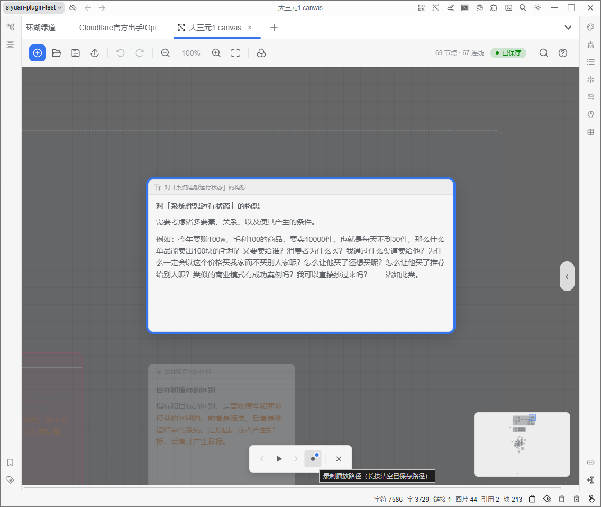
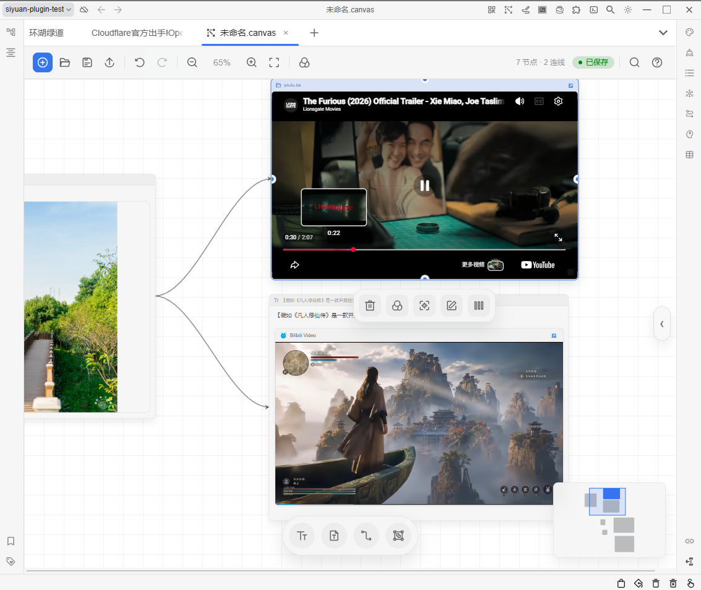
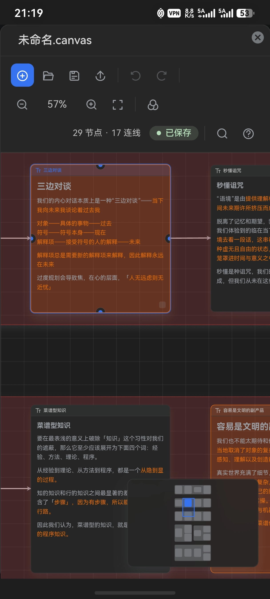
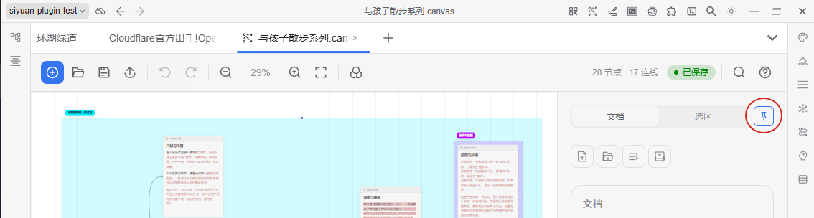

# 演示模式、视频卡片、移动端——无界 v1.4.0 新功能预览

~思源笔记  [*](https://ld246.com/article/1782050162702)

## 无界 v1.4.0

### 新增

- **演示模式**：

  - 支持按连线关系逐卡片播放演示，支持录制和播放自定义演示路径；
  - 支持多种播放效果，包括焦点卡片显示比例、背景透明度等；

  

  <video controls="controls" src="assets/演示模式-20260623213039-m77ylok.mp4"></video>
- **视频卡片**：卡片支持嵌入B站和Youtube视频，支持直接播放；

  

  <video controls="controls" src="assets/视频卡片-20260621215200-0480lrk.mp4"></video>
- **移动端适配（beta）** ：支持移动端查看Canvas文件（不支持编辑）；

  
- **动态浮动面板**：右侧面板支持“钉住”与“动态浮动”显示模式；

  

### 改进

- 支持从文件浏览器直接拖入图片文件到画布；
- 修复设置不显示标题栏后，卡片无法拖拽移动的问题；
- 修复嵌入图片节点预览问题和跟随卡片大小自适应问题；
- 调整放大缩小快捷键，避免与思源笔记内置的快捷键冲突；
- 右侧属性面板布局优化，支持垂直滚动；
- 修复拖拽连线预览路径与实际不一致问题；
- 编辑 Group 标签时隐藏浮动工具栏，避免遮挡；
- 其他UI和交互细节优化；

‍

## 附录

- [想象“无界”，思考有方 —— 一个兼容 Obsidian Canvas 的思源笔记插件 - 链滴](https://ld246.com/article/1777692508369)
- [无界 v1.2.0 大幅更新预警！ - 链滴](https://ld246.com/article/1779503358420)
- [让笔记与画布连接更紧密——无界 v1.3.0 新功能预览 - 链滴](https://ld246.com/article/1780823593732)
- [在笔记中嵌入 Canvas——无界 v1.3.5 新功能预览 - 链滴](https://ld246.com/article/1781407746870)
- [为了让思源笔记用起来更顺手，我打算开发 10 个插件，目前进度…… - 链滴](https://ld246.com/article/1775894033664)

‍
