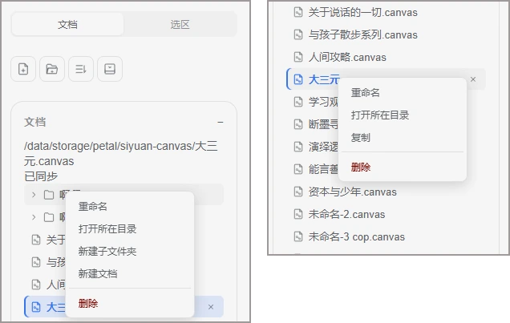
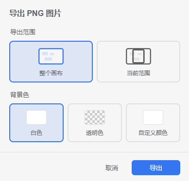
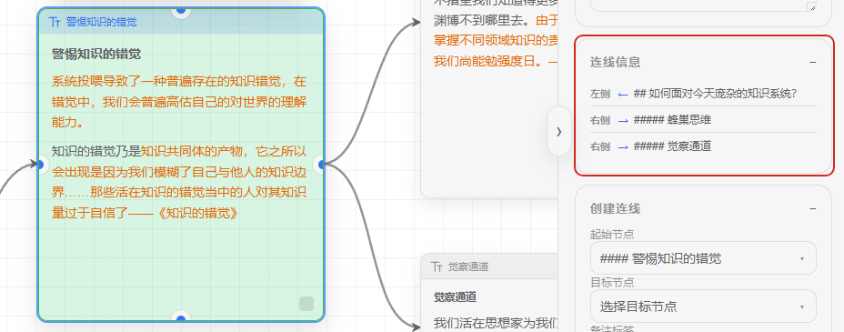

# 让笔记与画布连接更紧密——无界 v1.3.0 新功能预览

~思源笔记   [*](https://ld246.com/article/1780823593732)

## 无界 v1.3.0 新功能预览

1. ### 输入 `[[`​ 或 `【【` 快速添加笔记卡片（同思源笔记中查找和创建引用操作）；
2. ### 双击画布空白区域快速创建文本卡片；

   <video controls="controls" src="assets/2026-06-07-16-47-10-20260607164846-mv8uh7d.mp4"></video>
3. ### 支持向画布拖入文档、内容块，快速生成笔记卡片；

   <video controls="controls" src="assets/6月7日-20260607165839-ck3s3b3.mp4"></video>
4. ### 支持文本卡片与思源文档/块/图片卡片互相转换；

   <video controls="controls" src="assets/笔记与文本卡片互转-20260607170816-67mnksf.mp4"></video>
5. ### 提供文档树右键上下文菜单，支持重命名、复制、删除、打开所在目录、新建子文件夹和新建文档；

   
6. ### 支持将画布导出为图片；

   
7. ### 选区面板新增连线信息，可查看卡片各端点的连接关系；

   
8. ### 其他交互细节改进；

   8. 修复拖动单个卡片时其他卡片视觉位置跟随移动的问题；
   9. 重复添加卡片时会自动偏移位置，避免新卡片与已有卡片重叠；
9. ### 选中思源文档或块关联卡片后，可按空格键弹出浮窗预览；

   <video controls="controls" src="assets/浮窗预览-20260607170217-5gj4s5x.mp4"></video>

‍

## 附录

[无界 v1.2.0 大幅更新预警！ - 链滴](https://ld246.com/article/1779503358420)

[想象“无界”，思考有方 —— 一个兼容 Obsidian Canvas 的思源笔记插件 - 链滴](https://ld246.com/article/1777692508369)

[为了让思源笔记用起来更顺手，我打算开发 10 个插件，目前进度…… - 链滴](https://ld246.com/article/1775894033664)

‍
